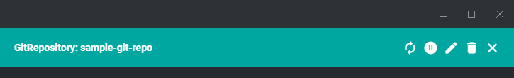
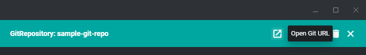

# freelens-flux-git-link

A FreeLens plugin that adds a menu item to open a FluxCD `GitRepository` in the default browser.

[日本語](README.md)

Viewing a `GitRepository` Custom Resource in FreeLens only shows `spec.url` as plain text; there is no built-in way to navigate to it, whether you're looking at the built-in Custom Resources pages or the official [freelens-fluxcd-extension](https://github.com/freelensapp/freelens-fluxcd-extension) pages.
See [docs/design.md](docs/design.md) for the full design rationale.

| Before | After |
|---|---|
|  |  |

`freelens-flux-git-link` adds an "Open Git URL" menu item to `GitRepository`, converting `spec.url` into an https (or http) URL and opening it in the default browser.
It handles `ssh://` URLs and scp-like syntax (`git@host:path`) too, and strips any credentials (userinfo) embedded in the URL before opening it.

## Compatibility

Requires FreeLens 1.8.0 or later (see `engines` in package.json).

## Install

1. Download the latest `.tgz` from GitHub Releases
2. Drag & drop it onto the Extensions screen in FreeLens
3. To update, repeat the same steps with the new `.tgz`

## Usage

1. Connect to a cluster in FreeLens and open a `GitRepository`'s object details drawer or a list page
2. "Open Git URL" appears as an icon in the details drawer's top toolbar, and as an icon+text row in the list page's row "⋮" menu
3. Clicking it opens the Git repository corresponding to `spec.url` in the default browser

If `spec.url` is unsupported (e.g. `oci://`), empty, or malformed, the menu item itself is not shown.

Only `GitRepository` is supported for now.
Support for other FluxCD source kinds (`OCIRepository`, `HelmRepository`) and deep links reflecting `spec.ref` are candidates for future work (see [design.md](docs/design.md)).

## Links

- https://github.com/AvapCoLtd/freelens-flux-git-link (public)
- https://gitlab.avaper.day/avap/freelens-plugins/freelens-flux-git-link (development)

Development: see [CONTRIBUTING.md](CONTRIBUTING.md).

## License

MIT
