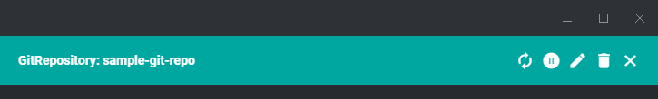
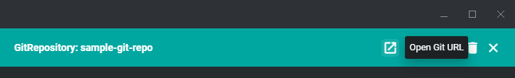

[English](README.en.md)

# freelens-flux-git-link

FluxCD の `GitRepository` を既定ブラウザで開くメニューを追加する FreeLens プラグイン。

FreeLens で `GitRepository` の Custom Resource を見ても、`spec.url` はテキストとして表示されるだけである。
そこへ遷移する手段が標準にはない。
組み込みの Custom Resources ページ、公式 [freelens-fluxcd-extension](https://github.com/freelensapp/freelens-fluxcd-extension) のページのいずれで見ていても同様である。
詳細は [設計ドキュメント](docs/design.md) を参照。

| Before | After |
|---|---|
|  |  |

`freelens-flux-git-link` は `GitRepository` に「Open Git URL」メニュー項目を追加する。
`spec.url` を https(または http)の URL に変換して既定ブラウザで開く。
`ssh://` や `git@host:path` のような scp 風構文にも対応する。
資格情報(userinfo)が URL に含まれる場合は取り除いてから開く。

## 対応バージョン

FreeLens 2.0.0以上(`package.json` の `engines` を参照)。1.xでは読み込まれない。

## インストール

1. GitHub Releases から最新の `.tgz` をダウンロードする
2. FreeLens の Extensions 画面にドラッグ&ドロップする
3. 更新時も同様に新しい `.tgz` を取得して再インストールする

## 使い方

1. FreeLens でクラスタに接続し、`GitRepository` のオブジェクト詳細ドロワー、または一覧ページを開く
2. 詳細ドロワーでは上部ツールバーにアイコン、一覧ページの行「⋮」メニューではアイコン+テキストの行として「Open Git URL」が表示される
3. クリックすると `spec.url` に対応する Git リポジトリが既定ブラウザで開く

`spec.url` が未対応スキーム(`oci://` 等)・空・不正な値の場合、メニュー項目自体が表示されない。

現時点では `GitRepository` のみが対象。
`OCIRepository` / `HelmRepository` 等の他の FluxCD ソース種別への対応は今後の対応候補である。
`spec.ref` を反映したディープリンクも同様である([design.md](docs/design.md) 参照)。

## リンク

- https://github.com/AvapCoLtd/freelens-flux-git-link (公開用)
- https://gitlab.avaper.day/avap/freelens-plugins/freelens-flux-git-link (開発用)

開発: [CONTRIBUTING.md](CONTRIBUTING.md) を参照。

## License

MIT
